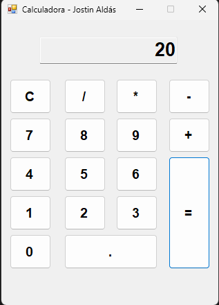
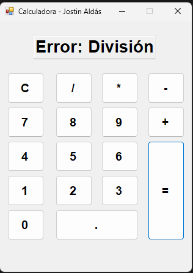

# PPE03 - Aplicación de Escritorio: Calculadora Básica en Windows Forms

**Asignatura:** Diseño y Programación de Software (ITID543)  
**Institución:** Escuela Politécnica Nacional  
**Estudiante:** Jostin Ariel Aldás Carrasco  
**Fecha de Entrega:** 17 de noviembre de 2026  

---

## 1. Descripción del Proyecto

El presente proyecto consiste en el diseño, desarrollo e implementación de una **Calculadora Básica de Escritorio** con interfaz gráfica de usuario (GUI), construida bajo el ecosistema de **.NET Windows Forms** y el lenguaje de programación **C#**.

La aplicación proporciona una experiencia interactiva para la realización de operaciones aritméticas elementales, aplicando los principios del diseño de software orientado a eventos, control de estados del formulario y validación preventiva de errores en tiempo de ejecución.

---

## 2. Requerimientos Funcionales Implementados

De acuerdo con la guía de laboratorio `PPE03`, se implementaron los siguientes requerimientos:

* **RF-01 (Visualización):** Pantalla superior mediante `TextBox` en modo de solo lectura (`ReadOnly = true`) con alineación derecha para la entrada y salida de datos.
* **RF-02 (Entrada Numérica):** Cuadrícula de botones interactivos para los dígitos del `0` al `9`.
* **RF-03 (Operaciones Básicas):** Ejecución de operaciones aritméticas estándar: Suma (`+`), Resta (`-`), Multiplicación (`*`) y División (`/`).
* **RF-04 (Cálculo de Resultados):** Botón Igual (`=`) para evaluar y procesar la operación aritmética seleccionada.
* **RF-05 (Reinicio de Estado):** Botón de Limpieza (`C`) para restablecer el visualizador a `0` y vaciar las variables en memoria.
* **RF-06 (Punto Decimal):** Botón (`.`) con validación de ocurrencia única para evitar la inserción de múltiples separadores.
* **RF-07 (Manejo de Excepciones):** Control defensivo ante intentos de división para cero (`/ 0`), desplegando un mensaje de advertencia y evitando caídas del sistema (*crash*).

---

## 3. Tecnologías Utilizadas

* **Lenguaje:** C# (.NET 8.0 / .NET Framework)
* **Plataforma:** Windows Forms (GUI Desktop)
* **Entorno de Desarrollo:** Visual Studio 2022
* **Control de Versiones:** Git y GitHub

---

## 4. Estructura del Repositorio

El repositorio mantiene una estructura desacoplada de archivos temporales de compilación (`bin/` y `obj/`), garantizando un despliegue limpio:

```text
PPE03_Aldas_Jostin_Calculadora/
├── Calculadora.slnx          # Archivo de la solución de Visual Studio
├── Calculadora/              # Carpeta del proyecto
│   ├── Form1.cs              # Lógica de programación por eventos
│   ├── Form1.Designer.cs     # Definición de controles visuales y propiedades
│   ├── Program.cs            # Punto de entrada de la aplicación
│   └── Calculadora.csproj    # Archivo de configuración del proyecto .NET
├── imagenes/                 # Capturas de pantalla de la aplicación
│   ├── calculadora_normal.png
│   └── calculadora_error.png
├── .gitignore                # Exclusión de archivos binarios y temporales
└── README.md                 # Documentación técnica del proyecto
```

---

## 5. Instrucciones de Compilación y Ejecución

### Prerrequisitos

- Sistema Operativo Windows 10 u 11.
- Visual Studio 2022 con la carga de trabajo *Desarrollo de escritorio de .NET* instalada.

### Pasos para Ejecutar

1. Clonar el repositorio localmente desde la terminal:

```bash
git clone https://github.com/Jostin-AAC/PPE03_Aldas_Jostin_Calculadora.git
```

2. Abrir la solución `Calculadora.slnx` en Visual Studio 2022.
3. Presionar la tecla `F5` o hacer clic en el botón verde **Iniciar** para compilar y ejecutar la aplicación.

---

#### 6. Capturas de Pantalla de la Aplicación

##### 6.1. Interfaz Principal en Funcionamiento

Muestra de la calculadora ejecutándose y procesando una operación aritmética:



##### 6.2. Validación y Control de Error (División por Cero)

Muestra del mensaje de control defensivo cuando el usuario intenta dividir para cero:



---

## 7. Tabla de Casos de Prueba

| **Caso de Prueba** | **Operación / Entradas** | **Resultado Esperado** | **Resultado Obtenido** | **Estado** |
| ------------------ | ------------------------ | ---------------------- | ---------------------- | ---------- |
| **CP-01** | `12 + 8 =` | `20` | `20` | **Aprobado** |
| **CP-02** | `50 - 15 =` | `35` | `35` | **Aprobado** |
| **CP-03** | `6 * 7 =` | `42` | `42` | **Aprobado** |
| **CP-04** | `84 / 4 =` | `21` | `21` | **Aprobado** |
| **CP-05** | `15 / 0 =` | `Error: División por cero` | `Error: División por cero` | **Aprobado** |
| **CP-06** | Presionar botón `C` | Pantalla en `0` y variables en cero | Pantalla en `0` | **Aprobado** |

---

## 8. Conclusiones y Recomendaciones

### Conclusiones

- La programación dirigida por eventos en Windows Forms permite una vinculación directa entre la interacción del usuario en la interfaz gráfica y los métodos de respuesta en el código de C#.
- La validación preventiva en operaciones aritméticas críticas (como la división por cero y la restricción del punto decimal) asegura la estabilidad y confiabilidad de la aplicación de escritorio, evitando caídas inesperadas en tiempo de ejecución.

### Recomendaciones

- Establecer la propiedad `ReadOnly = true` en el control `TextBox` de visualización para canalizar la entrada de datos exclusivamente a través de los eventos controlados de los botones.
- Mantener actualizadas las reglas del archivo `.gitignore` para evitar la subida de dependencias y ensamblados generados automáticamente (`bin/`, `obj/`) al repositorio remoto.